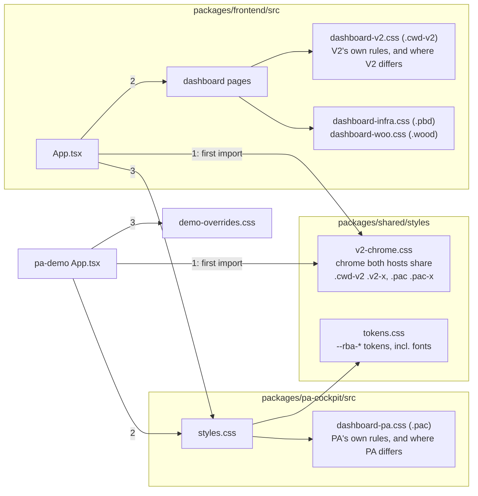

# CSS files — what each stylesheet is for

The repository tracks 26 `.css` files across the Keycloak theme, the shared
token files and four frontend packages. Nearly all of them scope every selector under a single
root class per surface (`.cwd-v2`, `.pbd`, `.wood`, `.pac`, `.lcp`, …), so a
stylesheet cannot leak into another app or dashboard. Tailwind is used for
utility classes; these files hold the hand-written, surface-specific styling.

To refresh the list: `git ls-files '*.css'`.

**Improvement plan:** [#374](https://github.com/sgort/ronl-business-api/issues/374)
records what is weak in the current approach and a stepwise plan to fix it.
The summary is under [State and planned improvements](#state-and-planned-improvements)
below; the issue's checklist tracks progress.

---

## Keycloak login theme

| File                                                            | Lines | Function                                                                                                                                                                                                                                 |
| --------------------------------------------------------------- | ----: | ---------------------------------------------------------------------------------------------------------------------------------------------------------------------------------------------------------------------------------------- |
| `keycloak-themes/ronl/login/resources/css/login.css`            |   447 | Custom Keycloak login theme, styled to match the MijnOmgeving landing page. Loaded by the theme's `theme.properties`. Mounted into the local Keycloak by the root `docker-compose.yml`. Colours from Flevoland's semantic tokens (#400). |
| `keycloak-themes/ronl/login/resources/css/flevoland-tokens.css` |   352 | Byte-identical copy of `packages/shared/styles/flevoland/tokens.css`, loaded before `login.css`. Written by `npm run sync:keycloak-tokens`; never edit by hand.                                                                          |

**This is the one copy of the theme** (#374 item 1). The ACC Keycloak compose
file (`deployment/vm/keycloak/acc/docker-compose.yml`) mounts
`/opt/keycloak/themes` from the VM host, and that directory is filled by hand
from `keycloak-themes/ronl/`. A stale second copy under `deployment/vm/` was
removed; automating the copy to the VM is #196.

**Colours: one Flevoland look for every tenant** (#400; design:
`docs/superpowers/specs/2026-10-31-keycloak-theme-flevoland-colours-design.md`).
Keycloak has one client for all tenants and cannot tell them apart before
sign-in. `login.css` uses Flevoland's semantic tokens only, never their
palette; only the DigiD, eHerkenning and eIDAS buttons keep their own hex
colours. Keycloak serves the theme outside our build, so it carries a copy of
the token file instead of importing it. After a new Flevoland delivery, run
`npm run sync:keycloak-tokens`. `packages/frontend/src/keycloak-theme.test.ts`
fails when the copy falls behind, when `theme.properties` stops loading it
first, or when `login.css` uses a token the copy does not define;
`css-hex.test.ts` covers the theme too.

Do not add an `@import` of the default Keycloak CSS to `login.css`:
`theme.properties` already loads the base styles, and an `@import` would load
PatternFly again _after_ the custom styles and override them.

## `packages/shared` — design tokens and the shared chrome

| File                          | Lines | Root class        | Function                                                                                                                                                                                                                                                                                                                                                                                                                                                                                                                                                                                            |
| ----------------------------- | ----: | ----------------- | --------------------------------------------------------------------------------------------------------------------------------------------------------------------------------------------------------------------------------------------------------------------------------------------------------------------------------------------------------------------------------------------------------------------------------------------------------------------------------------------------------------------------------------------------------------------------------------------------- |
| `styles/tokens.css`           |   154 | `:root`           | The shared design tokens (`--rba-*`): Flevoland's fixed brand colours, the themed brand (chained to the tenant's `--color-primary`/`-dark`/`--color-secondary`), the accent and warning fills with the text on them (`--rba-accent-fill`, `--rba-on-accent-fill`, `--rba-warn-fill`), the neutrals (with `--rba-ink-inverse` for text on a coloured fill) the status colours, and the v2 chrome's type families (`--rba-font-*`). Ends with `:root[data-tenant="flevoland"]`, which points them at Flevoland IT's semantic tokens for the Flevoland tenant. The palette's only home for hex values. |
| `styles/flevoland/tokens.css` |   352 | `:root`           | Flevoland IT's design tokens (`--flevoland-*`), copied verbatim from their `flevoland-base.css` v0.2.0 (12-10-2026): the file header and section 1. `styles/tokens.css` imports it, so both hosts load it. Do not edit by hand; diff a new delivery against it.                                                                                                                                                                                                                                                                                                                                     |
| `styles/v2-chrome.css`        |   517 | `.cwd-v2`, `.pac` | The dashboard chrome Caseworker V2 and PA-Cockpit share, each rule written once with both hosts' selectors (#374 item 4). Each app imports it first: the frontend's and pa-demo's `App.tsx`. See [The v2 chrome](#the-v2-chrome-shared-by-both-hosts-374-item-4) below.                                                                                                                                                                                                                                                                                                                             |
| `styles/flevoland/base.css`   |   636 | global            | The rest of that delivery, verbatim: `@font-face` for Fira Sans, element base styles (`:where()`), the NL Design System Button mapping, reduced-motion and forced-colours rules. **Not loaded**: step 2 of #374 switches apps over to it one at a time.                                                                                                                                                                                                                                                                                                                                             |

The caseworker app imports it in `App.tsx`; `@ronl/pa-cockpit`'s `styles.css`
`@import`s it, which is how `pa-demo` gets it. Each surface's own variables
(`--v2-*`, `--pac-*`, `--pb-*`, `--w-*`, the landing pages' `--blue`,
`--text`, …) point at a token rather than repeating the value.
`packages/frontend/src/css-tokens.test.ts` fails when a stylesheet uses a
`var(--rba-*)` the file does not define, or when a host stops loading it.

**Flevoland's colours (#374, step 1).** `services/tenant.ts` marks the active tenant with `data-tenant` on `<html>` (`TENANT_MARKER_ENABLED`, on since the last PR of step 1; pa-demo's shim mirrors it, and its theme literal follows `tenants.json`). For `flevoland`, the block at the end of `tokens.css` gives navy text, Material greys, the `#f8f8f8` page, dark blue `#003a8e`, Flevoland's status colours, brown warning text and markers, and yellow fills with dark text. Pink stays for accent text and lines. `css-tokens.test.ts` keeps the block on Flevoland's semantic tokens; `css-colour.test.ts` checks its contrast. `npm run check:css-equivalence` leaves the `[data-tenant]` rules out, so it still proves other tenants unchanged; its `flevoland` environment covers Flevoland without the marker.

**Other tenants must not change when colours move into tokens.** `npm run check:css-equivalence` compares each changed stylesheet with the same file on `acc` (`--base <ref>` for another), resolving every `var()` and `color-mix()` as each tenant other than Flevoland sees it, and fails when a colour moves by more than ΔE2000 1.0 (not visible) or anything else in a declaration changes. Script: `scripts/css-colour/check-equivalence.mjs`; its tests are in `packages/frontend/src/css-colour.test.ts`.

**Hard-coded colours (#374 step 1, PR 3).** The stylesheets and inline styles
use the tokens for every neutral, brand and status colour. Pale status tints
were merged by role into `--rba-ok-*`, `--rba-warn-*` and `--rba-bad-*`
(`-bg` backgrounds, `-line` borders, `-ink` text, `-strong` marks), each
defaulting to its most-used value; near-duplicates moved to that value (up to
ΔE2000 6.9), a decision taken with the user for one consistent tint per role.
Brand blue and pink tints are `color-mix()` of the fixed Flevoland tokens.
Surface variables that kept their own values (`--pac-green`, `--pac-amber`,
the landing pages' `--ink`, `--muted`, `--line`, the login portal's
`--amber`) now point at tokens too.

Left as hex on purpose, as data or category colours: the purple "AI", media
and OB tags and the EU indigo in `dashboard-pa.css`, the Woo teal, the light
green on the dark toast, `--sim-hold` in `regelsimulatie.css`, and in TS/TSX
the chart series, lane colours and `wachtend` (`inline-colours.test.ts`
lists them per file).

### The v2 chrome, shared by both hosts (#374 item 4)

The dashboard chrome (top bar, logo, search, user block, mode tabs, body
grid, left rail, main area, buttons, no-access panel, empty state, ⌘K
palette, assistant dock) used to exist twice: under `.cwd-v2` in
`dashboard-v2.css` and, with `.pac-*` class names, in `dashboard-pa.css`.
Every declaration that was identical in both now lives once in
`styles/v2-chrome.css`, as one rule with both hosts' selectors:

```css
.cwd-v2 .v2-topbar,
.pac .pac-topbar {
  background: var(--rba-brand);
  height: 56px;
  /* … */
}
```

Where the two hosts differ (the rail is 240px in V2 and 248px in PA, for
example), each keeps its own declaration in its own file. A chrome rule can
therefore be spread over three places: the shared file, the host file, and a
surface layered on it (Infra-board, Woo). The shared file always loads first.



**Load order decides.** At equal specificity the later rule wins, so the
order in which each app loads these files is part of the design. This is the
order the browser applies them in (abridged; `npm run check:css-move -- --files`
prints the full list):

```mermaid
flowchart TB
  subgraph fe["Frontend: Caseworker V2, Infra-board, Woo, and PA-Cockpit in the app"]
    direction LR
    f1["v2-chrome.css"] --> f2["process and signing<br/>component CSS"] --> f3["dashboard-v2.css<br/>regelsimulatie.css"] --> f4["dashboard-infra.css<br/>dashboard-woo.css"] --> f5["landing pages<br/>index.css (Tailwind)"] --> f6["tokens.css"] --> f7["dashboard-pa.css<br/>dossierbeheer.css"]
  end
  subgraph demo["pa-demo"]
    direction LR
    d1["v2-chrome.css"] --> d2["changelog.css"] --> d3["tokens.css"] --> d4["dashboard-pa.css<br/>dossierbeheer.css"] --> d5["demo-overrides.css"] --> d6["index.css"]
  end
```



- **Each app imports `v2-chrome.css` itself, as its first stylesheet:** the
  frontend at the top of `App.tsx`, above the page imports (whose modules
  bring `dashboard-v2.css` and the Infra-board and Woo layers); pa-demo in
  its `App.tsx`, above `@ronl/pa-cockpit`. `styles.css` does **not** import it:
  in the frontend that would place the shared rules after the dashboard pages,
  where they would beat the layers (`.pbd .v2-rail-card` would lose its
  `padding-bottom`). Never import it anywhere else either. `css-tokens.test.ts`
  checks both imports and that there is no third.
- **The shared file uses `--rba-*` tokens only.** `--v2-*` exists only under
  `.cwd-v2` and `--pac-*` only under `.pac`, so neither works in a rule for
  both. The fonts got tokens for this (`--rba-font-serif/-sans/-mono`).
- **Accent colours stay in the host files.** Infra-board and Woo set
  `--v2-accent` inline on their root, to keep Flevoland's pink whatever the
  tenant. `--rba-accent` is defined on `:root` and would ignore that, so every
  declaration that uses the accent (logo `em`, active tab and rail item,
  crumb, dock resize handle) keeps `var(--v2-accent…)` in `dashboard-v2.css`.
  `css-tokens.test.ts` keeps `--rba-accent` out of the shared file.
- **A few identical declarations stayed in the host files** because moving
  them would have changed which rule wins:
  - `.v2-btn`'s `padding` and `font-size`, and the small button's
    `font-size`: in V2, `.v2-btn-sm` comes before `.v2-btn`, so `.v2-btn`
    wins today, also on small buttons;
  - the palette's `li .mode` and `li .label` text styles, and
    `.v2-no-access-meta code`'s `font-size` and `padding`: the check cannot
    tell these `span` and `code` elements from others with the same element
    type elsewhere.

**Changing the chrome.** Restyle a piece for both hosts in `v2-chrome.css`.
If one host must differ, put that declaration in the host's file, not in
the shared one. `pa-cockpit-class-coverage.test.ts` checks that every `v2-*`
class a cockpit component renders is styled for `.pac`, in `dashboard-pa.css`
or in the shared file.

**Proving a move changes nothing: `npm run check:css-move`.** The per-file
`check:css-equivalence` sees a moved rule as removed and added. This check
compares an app's whole cascade instead: every stylesheet it loads, in the
order the browser applies them (read from the import graph from its
`main.tsx`), at `acc` and in the working tree.

- Per selector and property, the winning value must be the same for every
  tenant.
- Two declarations that set a longhand in common (the same property, or a
  shorthand and its longhands) must keep their order, when their selectors
  have equal specificity and can style the same element.
- Which classes an app renders, and which share an element, it reads from the
  `className` attributes of the components that app loads. Each app also
  declares its page roots that are never nested (`.cwd-v2`, `.pac`, the
  landing pages).

Its limits:

- it does not see a custom property set inline on an element (hence the
  accent rule above);
- it does not follow a className composed across components;
- it does not compare ancestors, so two `code` rules under different parents
  count as competing;
- it does not expand Tailwind: `index.css` is read as written. PA's chrome
  now loads before it in the frontend; the review checked the elements
  involved by hand (the `.pac` and palette roots carry no utility classes);
- it compares order within one at-rule chain only, not a rule inside
  `@media` against the same selector outside it (no such case today).

The apps and their roots are defined in `scripts/css-colour/check-move.mjs`;
item 5 can use the check as it is. Tests: `packages/frontend/src/css-move.test.ts`.

## `packages/frontend` — caseworker and board app

| File                                            | Lines | Root class        | Function                                                                                                                                                                                                                                                                                                                                                                           |
| ----------------------------------------------- | ----: | ----------------- | ---------------------------------------------------------------------------------------------------------------------------------------------------------------------------------------------------------------------------------------------------------------------------------------------------------------------------------------------------------------------------------- |
| `src/index.css`                                 |    25 | `:root`           | App-shell entry: the Tailwind directives and the default brand custom properties (`--color-primary`, …) that tenant theming overrides at runtime.                                                                                                                                                                                                                                  |
| `src/styles/tailwind-palette.css`               |   210 | `:root`           | Tailwind's colour scales (`gray`, `slate`, `red`, `green`, `blue`, `amber`, `orange`, `yellow`) as `--twc-*` variables, which `tailwind.config.js` points the scales at. Defaults are Tailwind's own values; `:root[data-tenant="flevoland"]` maps each shade onto Flevoland's colours by role (#374). No opacity modifiers on these scales: `tailwind-palette.test.ts` checks it. |
| `src/pages/caseworker-v2/dashboard-v2.css`      |   698 | `.cwd-v2`         | Caseworker Dashboard V2: its own sections, and the chrome declarations where it differs from PA (the shared chrome is in `@ronl/shared`'s `v2-chrome.css`). Its chrome and tokens are reused by the Infra-board and WOO dashboards, whose root element carries both classes.                                                                                                       |
| `src/pages/caseworker-v2/regelsimulatie.css`    |   151 | `.cwd-v2`         | Regelsimulatie (rule simulation) view, ported from the handoff's `sim.css`. Adds no new colours — it reuses the existing tokens.                                                                                                                                                                                                                                                   |
| `src/pages/infra-board/dashboard-infra.css`     |  1065 | `.pbd`            | Project/Infra-board sections: Mijn dag, Portfolio and Project. Builds on the `.cwd-v2` chrome.                                                                                                                                                                                                                                                                                     |
| `src/pages/woo/dashboard-woo.css`               |   289 | `.wood`           | WOO dashboard sections, also on the `.cwd-v2` chrome.                                                                                                                                                                                                                                                                                                                              |
| `src/pages/login-choice/login-portal.css`       |   551 | `.lcp`            | The unauthenticated landing page at `/`: the Provincie Flevoland board catalogue.                                                                                                                                                                                                                                                                                                  |
| `src/components/LoginChoice/single-board.css`   |   366 | `.lcp-single`     | Landing page for a tenant with a single board (`/?tenant=<id>`). Tenant colour comes only from the theme variables set on `:root`.                                                                                                                                                                                                                                                 |
| `src/components/LoginChoice/access-denied.css`  |    96 | `.lcp-denied`     | The no-access dialog on the landing pages (`AccessDeniedDialog`).                                                                                                                                                                                                                                                                                                                  |
| `src/components/process/process-view.css`       |   158 | `.pbd`            | Phase stepper and BPMN swimlane, shared by the Infra-board and the caseworker process view. Moved verbatim from `dashboard-infra.css`; a caseworker container opts in with `pbd`.                                                                                                                                                                                                  |
| `src/components/process/caseworker-process.css` |   106 | `.cwd-v2`, `.pbd` | Caseworker process view: "Waar sta ik", process steps per role, and the swimlane overlay in the Taken inbox.                                                                                                                                                                                                                                                                       |
| `src/components/process/process-disclosure.css` |     9 | `.cwd-v2`         | The folded "Procesgegevens" disclosure (`ProcessVarsDisclosure`) on every dashboard's task panel.                                                                                                                                                                                                                                                                                  |
| `src/components/signing/signing-panel.css`      |    42 | `.pb-sign-panel`  | The ValidSign signing panel embedded in task views. Owned by the component, not a dashboard, because the Infra-board and the caseworker inbox both show it.                                                                                                                                                                                                                        |

## `packages/pa-cockpit` — shared PA-Cockpit package

| File                                            | Lines | Root class | Function                                                                                                                                                                                                                                |
| ----------------------------------------------- | ----: | ---------- | --------------------------------------------------------------------------------------------------------------------------------------------------------------------------------------------------------------------------------------- |
| `src/styles.css`                                |    19 | —          | The package's stylesheet entry; hosts import `@ronl/pa-cockpit/styles.css`. It imports the tokens and the cockpit sheets, and deliberately leaves out the app-shell `index.css` and the shared v2 chrome (each app imports that first). |
| `src/pages/public-affairs-v2/dashboard-pa.css`  |  1773 | `.pac`     | PA-Cockpit Flevoland, the largest stylesheet in the repository: its own sections, and the chrome declarations where it differs from V2.                                                                                                 |
| `src/pages/public-affairs-v2/dossierbeheer.css` |   237 | `.pac`     | The Dossierbeheer authoring surface at `/pa/dossiers`; its classes are `.pac-db-*`. Extends `dashboard-pa.css` and reuses its `--pac-*` tokens.                                                                                         |

## `packages/pa-demo` — public PA demo

| File                               | Lines | Root class          | Function                                                                                                                                                                            |
| ---------------------------------- | ----: | ------------------- | ----------------------------------------------------------------------------------------------------------------------------------------------------------------------------------- |
| `src/index.css`                    |    41 | `:root`             | The demo's own copy of the app shell (Tailwind entry, resets, brand custom properties) that it renders the cockpit inside.                                                          |
| `src/demo/demo-overrides.css`      |   133 | `.pac`              | Overrides of the cockpit's chrome that hold for this public deployment only; the shared package keeps those controls for the authenticated app.                                     |
| `src/demo/changelog/changelog.css` |   126 | `.pac-dchangelog-*` | The demo changelog panel. Plain CSS rather than Tailwind: a host without a matching `content` glob silently loses Tailwind classes, and this package has no build step to catch it. |

## `packages/public-site` — Open Regels

| File                 | Lines | Root class | Function                                                                                                                               |
| -------------------- | ----: | ---------- | -------------------------------------------------------------------------------------------------------------------------------------- |
| `src/styles/pub.css` |  1150 | `:root`    | The whole public search site: Rijkshuisstijl / NL Design System tokens. Fira Sans stands in for RO Sans, which is not redistributable. |

---

## Formatting

The repository's Prettier scope is `ts`, `tsx`, `json` and `md` — CSS is not
in it. Several files (`dashboard-pa.css`, `caseworker-process.css`) use a
one-rule-per-line style on purpose. Never run `prettier --write` on a `.css`
file.

## Linting (report-only)

Stylelint checks every tracked `.css` file against four rules. For now it
**reports only**: every rule is a warning, so the commands below always exit
0, and nothing runs in CI or in the pre-commit hook. Turning rules into errors
and wiring them into CI is a later step of
[#374](https://github.com/sgort/ronl-business-api/issues/374).

| Command                    | Output                                                |
| -------------------------- | ----------------------------------------------------- |
| `npm run lint:css`         | Every warning, line by line.                          |
| `npm run lint:css:summary` | A Markdown table: warnings per rule and per file.     |
| `npm run test:stylelint`   | The tests for the custom rule and the summary script. |

| Rule                       | Checks                                                                                                                                                                                                 |
| -------------------------- | ------------------------------------------------------------------------------------------------------------------------------------------------------------------------------------------------------ |
| `rba/selector-root-class`  | Every selector in a scoped stylesheet starts with that file's root class. Global files are exempt.                                                                                                     |
| `color-no-hex`             | No hex colours outside the shared token file. `HEX_ALLOWED` in the config lists it and the files exempt for their own reasons (the Keycloak theme's token copy, `pub.css`, the `index.css` fallbacks). |
| `no-duplicate-selectors`   | The same selector defined twice in one file.                                                                                                                                                           |
| `declaration-no-important` | No `!important`.                                                                                                                                                                                       |

The configuration is `stylelint.config.mjs`; its `ROOTS` map sets each scoped
file's root class(es). The custom rule lives in
`scripts/stylelint/selector-root-class.mjs`. When you add a scoped stylesheet,
add it to `ROOTS`.

**Baseline, 12 October 2026:** 889 warnings in 19 of 20 files — 800 hex
colours, 75 selectors outside their root class, 8 `!important` and 6
duplicate selectors. Of the 75 selectors:

- 53 style overlays by a prefixed class rather than under the root: the
  command palettes (`.cwd-v2-palette*`, 11; `.pac-palette*`, 11) and a modal
  in `dashboard-pa.css` (`.pac-zcm-*`, 31);
- 17 are `.pb-tweaks` rules in `dashboard-infra.css` that no component uses;
- 5 are in the demo's `demo-overrides.css`: four deliberate page-level rules
  (`html`, `body`, `#root`) and one `.pac-db-*` rule outside `.pac`.

**After the shared tokens (#374 item 3):** 843 warnings in 19 of 21 files.
Moving the surface variables onto the tokens took the hex count from 800 to
754; the other three rules are unchanged.

**After step 3a:** 458 warnings in 17 of 21 files, 369 of them hex. The
exemptions (A–C) and the replacements (F, G) below took the hex count from
754 to 369.

### The remaining hex values

_Status 30 October 2026: categories D, E, H and I are done (#374 step 1, PR 3). 22 `color-no-hex` warnings remain, all data or category colours; see [`packages/shared`](#packagesshared--design-tokens). The table below is the October 12 plan, kept for the record._

The 754 `color-no-hex` warnings, measured 12 October 2026 after item 3. Zero
is not the goal. The plan: exempt what cannot or should not use the tokens,
replace what maps to a token with no visual change, settle the brand
literals with Flevoland, and stop the count from growing. The long tail gets
replaced when someone is already editing that section.

|     | Category                                              | Count | Approach                                                                                                                                                                                                                |
| --- | ----------------------------------------------------- | ----: | ----------------------------------------------------------------------------------------------------------------------------------------------------------------------------------------------------------------------- |
| A   | The two Keycloak `login.css` copies                   |    98 | **Done (3a):** exempt. Keycloak serves them outside the build, so they cannot load the token file. _Since #400: one copy, on Flevoland's tokens through a committed copy, and no longer exempt._                        |
| B   | `public-site`'s `pub.css`                             |    85 | **Done (3a):** exempt; it is a separate brand (Rijkshuisstijl). Giving it its own `:root` token block remains an option.                                                                                                |
| C   | `--color-*` defaults in the two `index.css` files     |    10 | **Done (3a):** exempt. These are the tenant-theme fallbacks, not palette colours.                                                                                                                                       |
| D   | Surface variables with a different value              |    18 | Wait for the design decision in the table under [`packages/shared`](#packagesshared--design-tokens), then point them at tokens.                                                                                         |
| E   | Flevoland blue, dark blue or pink written into a rule |    24 | Decide per place. The fixed token changes nothing; the themed `--rba-brand` recolours the page for other tenants. In the dashboards, whose chrome is already themed, a hard-coded blue is probably a missed spot.       |
| F   | `#fff` / `#ffffff` in a rule                          |   129 | **Done (3a):** `--rba-ink-inverse` on `color` (text on the brand colour or a status fill), `--rba-paper` everywhere else. No visual change.                                                                             |
| G   | An exact match of a shared token                      |    63 | **Done (3a):** replaced with the `--rba-*` token itself, not the surface variable: a surface variable can be overridden locally (the Infra-board sets `--v2-accent` inline), a token only on `:root`. No visual change. |
| H   | Hex with transparency (`#0046ad18`)                   |    26 | The same decision as E, then `color-mix(in srgb, var(--rba-…) 9%, transparent)`.                                                                                                                                        |
| I   | Other tints and one-offs                              |   301 | 146 distinct values; 30 of them are used three or more times (158 uses) and could become a small tint scale (`--rba-brand-50`, `--rba-ok-50`, …). The other ~140 stay until their section is edited.                    |

Proposed order, one PR each:

1. **Exemptions plus G and F.** Done: changes nothing visually and brought
   the count to 369, every one of which now means something.
2. **E and H**, with a list for Flevoland to choose fixed or themed per place.
3. **A tint scale** for the 30 repeated values. Tints built with `color-mix`
   shift slightly, so this one changes pixels and needs a visual check.
4. **A ratchet in CI**, the "make it an error" step of item 2. _Done (#374 3d): with only data colours left, the gate lists them instead of counting. `packages/frontend/src/css-hex.test.ts` runs stylelint's `color-no-hex` with the repository config in the frontend suite (so in CI on every frontend, shared, pa-cockpit or Keycloak-theme pull request) and fails on any hex outside its per-file list of data colours, each with its reason, and on a listed colour that is no longer used. The other stylelint rules stay report-only._

## Default for new work

Write new styling as scoped CSS: one root class per surface, as the V2
dashboards do, and colocate a component's styles with the component (as
`process-view.css` and `signing-panel.css` are). Use existing custom
properties rather than new hex values: a surface variable or a shared
`--rba-*` token. Leave the older Tailwind-styled
components as they are; do not migrate them.

## State and planned improvements

Measured 12 October 2026; tracked in
[#374](https://github.com/sgort/ronl-business-api/issues/374).

**What is weak:**

- **No shared design tokens.** 225 distinct hex colours across the
  stylesheets. Flevoland blue `#0046ad` is written out 51 times in 11 files,
  and every file redefines its own `--ink`, `--text`, `--muted` and `--line`.
  _Since item 3: the shared token file exists and the surface variables
  point at it; since 3a, rules use it for white and exact matches too. Since step 1 of
  the Flevoland colours (PR 3), 22 hex values remain, all data colours._
- **Rules enforced only by comments.** The scoping rule, "no new colours",
  "no prettier" and "no `@import` in `login.css`" exist only as comments.
  _Since item 2: stylelint reports the first two, but does not enforce them
  yet._
- **Copies that drift.** The two Keycloak `login.css` files (_done, item 1:
  one copy left_); the
  `pa-demo` copy of the app shell; and the cockpit's copy of every `v2-*`
  rule, which `pa-cockpit-class-coverage.test.ts` exists to guard (_done,
  item 4: the shared chrome is in `v2-chrome.css`_).
- **Very large files.** `dashboard-pa.css` (2,046 lines),
  `dashboard-infra.css` and `dashboard-v2.css` (over 1,000 each).
- **Two styling approaches.** 33 older frontend components use Tailwind
  utilities; the V2 surfaces use scoped CSS.

**Plan**, in order of value for effort, one PR per step:

1. Guard the Keycloak copies: deploy from one source, or check in CI that
   they are identical. _Done: one source, `keycloak-themes/ronl/`._
2. Add stylelint, report-only at first: selectors start with the root class,
   no hex outside a token file, no duplicate selectors, no `!important`.
3. One shared token file (for example in `@ronl/shared`) for the Flevoland
   palette, the neutral greys and the status colours. `public-site` keeps its
   own Rijkshuisstijl tokens.
4. Export a shared stylesheet for the `v2-*` chrome that both hosts import,
   removing the cockpit's copied rules. _Done: `packages/shared/styles/v2-chrome.css`,
   proved unchanged per host with `npm run check:css-move`._
5. Split the large stylesheets section by section, only when already editing
   that section.
6. Scoped CSS on shared tokens as the default for new work (see above).

**Out of scope:** CSS Modules, CSS-in-JS or a Tailwind rewrite. Scoping by
root class already gives the isolation these would buy, at a fraction of the
migration cost.
